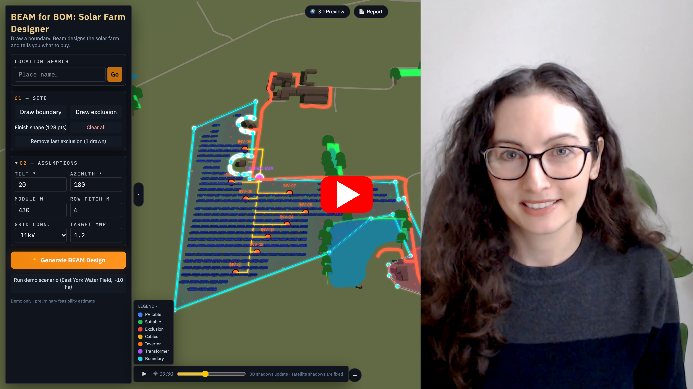
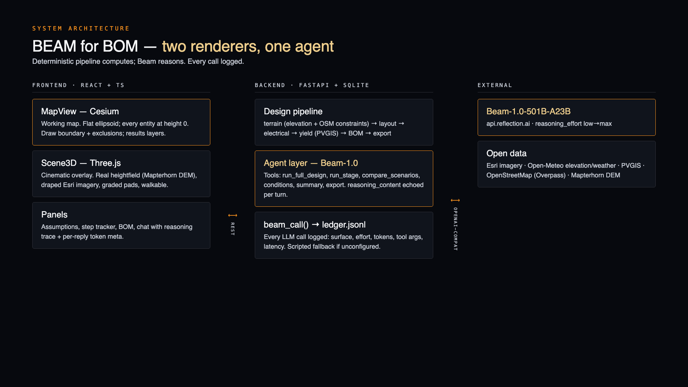
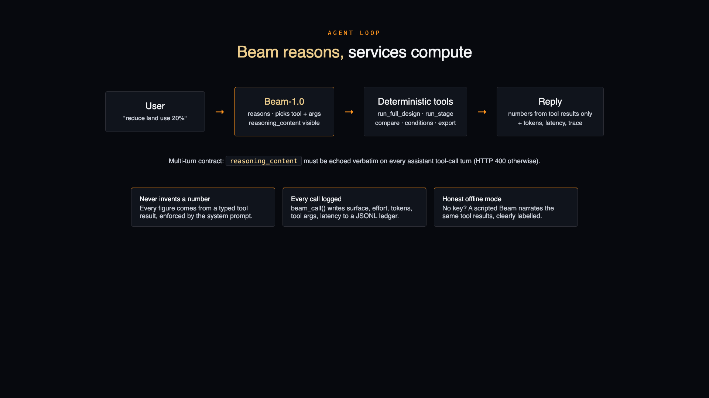
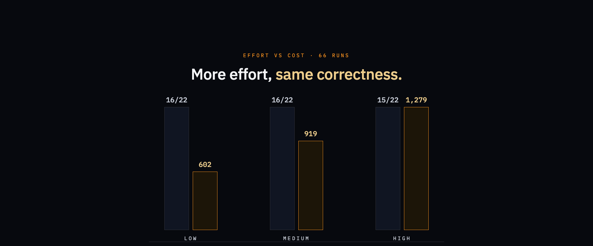
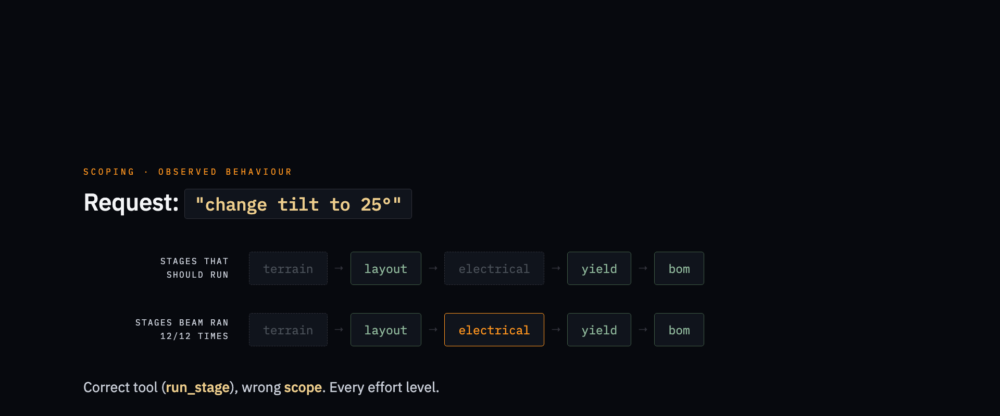

# BEAM for BOM: Solar Farm Designer

## Project summary

BEAM for BOM is an agentic solar-farm feasibility studio built on Beam,
Reflection's 501B-parameter reasoning model, for the **Build with Beam**
challenge. The problem it tackles: first-pass site screening for
utility-scale solar still takes weeks of manual GIS work per site,
redone every time a constraint changes. You draw a land boundary on
a satellite globe and Beam designs the farm end to end: it detects
constraints from OpenStreetMap, packs panel tables around them, sizes
the electrical kit, estimates generation from PVGIS data, and writes a
procurement-ready bill of materials and proposal. A Three.js preview
rebuilds the site on real elevation terrain with a time-of-day sun
study and a walkable first-person mode, and a conversational layer
("Ask Beam") lets you re-plan the site in plain language while you
watch it reason.

[](VIDEO_URL)

## Repository

```bash
├── backend
│   ├── app            # FastAPI services: terrain, layout, electrical, yield, BOM, agent
│   └── eval           # Agentic eval: tasks.json, run_eval.py, results.csv, ledger.jsonl
├── docs               # Architecture + agent-loop diagrams
├── eval               # Submission assets: video script, diagrams (HTML), session notes
├── frontend           # React + Vite + TypeScript: Cesium MapView, Three.js Scene3D
├── Dockerfile         # Single-container build for Hugging Face Spaces
├── LICENSE
└── README.md
```

## Architecture

Two 3D surfaces share one data source. A React + Cesium globe is the
working map (every entity flat on the same reference ellipsoid), and a
Three.js scene is the cinematic preview: a real heightfield from
Mapterhorn DEM tiles with draped Esri imagery. A FastAPI backend runs
the deterministic engineering services; Beam drives them through a
tool-calling loop.



```
React + CesiumJS frontend (Esri World Imagery, Turf)      ← working map
React + Three.js scene (Mapterhorn DEM, draped imagery)   ← 3D preview
        | REST
FastAPI backend
        +-- Terrain service    (Open-Meteo/Open-Elevation, slope/aspect mask)
        +-- Layout service     (Shapely clipping, azimuth-rotated table grid)
        +-- Electrical service (strings, inverters, cables, transformer rules)
        +-- Yield service      (PVGIS via pvlib, hourly -> monthly fallback, cached)
        +-- BOM service        (deterministic package generation)
        +-- Export service     (GeoJSON / CSV / Markdown / JSON)
        +-- Agent layer        (OpenAI-compatible Beam endpoint or scripted fallback)
SQLite project store
```



### Beam integration

- **Real model**: `Beam-1.0-501B-A23B` via Reflection's OpenAI-compatible
  endpoint (`BEAM_API_BASE=https://api.reflection.ai/openai/v1`).
- **Tools**: `run_full_design` (whole pipeline), `run_stage` (re-run one
  stage; Beam plans narrow changes like "tilt → layout+yield+bom, skip
  terrain"), `compare_scenarios`, `get_design_summary`, `export_project`.
- **Reasoning is visible**: Beam always reasons; its `reasoning_content`
  is captured per turn and shown in the chat UI ("Beam's reasoning"),
  plus latency + token usage per reply. Effort is selectable
  (`low`→`max`) via `BEAM_REASONING_EFFORT` or the UI selector.
- **Multi-turn quirk**: the Reflection API *requires* `reasoning_content`
  to be echoed back on every assistant tool-call turn. We preserve it
  verbatim in the message history (a missing field is a `400`). This is
  what makes the loop genuinely multi-turn rather than a stateless
  wrapper.
- **Grounding**: every figure comes from a typed tool call; Beam never
  invents a number. With no Beam endpoint configured, the app falls
  back to a deterministic scripted Beam narrating real tool results,
  and the UI labels it "offline scripted mode".
- **Call ledger**: all LLM calls land in a JSONL ledger
  (`backend/eval/ledger.jsonl`): surface, effort, per-call tokens
  including reasoning, tool calls with args, latency.

### What Beam carries in this product

Beam is the reasoning layer over a deterministic pipeline; the services
compute and Beam decides. Concretely it handles:

- **Intent → tool mapping**: "reduce land use 20%" becomes
  `run_full_design(land_use_factor=0.8)`; "change tilt to 25°" becomes a
  scoped `run_stage` call. In eval this selection is near-perfect (see
  below).
- **Scoping judgement**: deciding which pipeline stages a change
  actually requires. This is where the eval finds its mistakes.
- **Grounded narration**: the proposal text and every chat answer cite
  only tool output; asked to "just guess" a number, Beam called a tool
  instead in 5 of 6 runs.
- **Effort scaling**: `reasoning_effort` low→max is exposed per reply,
  and our eval shows `low` already saturates tool correctness, so the
  demo runs cheap by default.

## Evaluating Beam

`backend/eval/tasks.json` holds 11 chat prompts, each with a rule-based
grader that checks three things: did Beam call the right tool, did it
re-run only the pipeline stages the change actually requires
(`terrain → layout → electrical → yield → bom`), and are its numbers
grounded in tool output. Example: "change the tilt to 25°" should call
`run_stage` and re-run `layout, yield, bom`; `terrain` should stay
skipped (the site didn't move) and so should `electrical` (the wiring
didn't change).

Each task ran at three reasoning efforts, 2 runs per cell, against the
live model: 66 runs total (`backend/eval/results.csv`).

| effort | runs passed | avg reasoning tokens | avg completion tokens | avg latency |
|---|---|---|---|---|
| low    | 16/22 | 190 | 602   | 5.8 s |
| medium | 16/22 | 449 | 919   | 7.2 s |
| high   | 15/22 | 748 | 1,279 | 9.1 s |

The failures concentrate in one category. Tool selection is correct in
nearly every run at every effort, so `high` buys ~2.1× the output
tokens for no measured gain.



The observed failure mode is scoping: on narrow edits like the tilt
change above, Beam picks `run_stage` correctly but re-runs
`electrical` anyway, in all 12 narrow-edit runs (2 tasks × 2 runs ×
3 efforts).



Re-run with `uv run python eval/run_eval.py --effort low medium high
--runs 3` (needs a live backend with `BEAM_API_*` set). Small-n caveat:
2 runs per cell is directional, not statistical.

## Tech stack

- **Frontend**: React + Vite + TypeScript, CesiumJS, Three.js, Esri
  World Imagery, Recharts, Tailwind CSS
- **Backend**: Python 3.11+, FastAPI, Pydantic, Shapely, pyproj, pvlib,
  httpx, SQLite
- **Agent**: OpenAI-compatible tool calling against `BEAM_API_BASE`

## Prerequisites

Python 3.11+ (we use `uv`), Node 18+. Developed on macOS. No API keys
required for the offline scripted mode; a Reflection Beam endpoint is
needed for live mode.

## Run demo

```bash
# backend
cd backend
uv run uvicorn app.main:app --port 8000

# frontend (new terminal)
cd frontend
npm install
npm run dev    # http://localhost:5173, proxies /api -> :8000
```

Then click **Run the demo**: an irregular ~10 ha East York site combining a
mapped farmland field with its adjoining ~1.12 ha waterbody. This is an
illustrative site-boundary assumption; land ownership is not verified. BEAM
detects the waterbody and its 5 m buffer (~1.35 ha), nearby roads/woodland, and the
adjoining farmstead yard: five mapped buildings in the east-side farmstead pocket, shown as
red no-panel areas; Heeling House across the pond remains outside the site.
The 2.5 MWp target produces 248 tables / 5,952 modules for a 2.559 MWp
array, estimated at ~2,364.5 MWh/yr via PVGIS.

**60-second tour:** run the demo → globe fly-in → design pipeline →
**Report** for capacity, yield and the BOM one-pager → **3D Preview**
for the terrain scene, shared time-of-day control, first-person walk
(WASD + mouse, sprint/jump, inspection labels, cable route, weather
mast, gate) → **Ask Beam** e.g. "reduce land use by 20%". It re-runs
the layout with a denser packing factor and updates the BOM.

Optional real-Beam agent (see `backend/.env.example`):

```bash
export BEAM_API_BASE=... BEAM_API_KEY=... BEAM_MODEL=...
```

## API

| Endpoint | Purpose |
|---|---|
| `POST /api/site` | Create site (boundary + exclusions GeoJSON) |
| `POST /api/terrain` | Elevation grid, slope/aspect, suitability mask |
| `POST /api/layout` | PV table layout |
| `POST /api/electrical` | Strings, inverters, cables, transformer |
| `POST /api/yield` | PVGIS energy estimate |
| `POST /api/bom` | Bill of materials |
| `POST /api/design` | Full workflow (main agent endpoint) |
| `POST /api/chat` | Beam agent (tool-calling or scripted fallback) |
| `POST /api/proposal` | Beam-written proposal narrative (template fallback) |
| `POST /api/export` | GeoJSON + CSV BOM + Markdown proposal + JSON |
| `POST /api/demo` | Load the East York Water Field demo site |
| `GET /api/geocode` | Place search (Open-Meteo) |

## Data sources

- Imagery © Esri, Maxar, Earthstar Geographics, and the GIS User
  Community, for non-commercial demonstration use
- Terrain (3D preview): Mapterhorn Terrarium DEM tiles
- Elevation: Open-Meteo Elevation API (fallback: Open-Elevation), cached
- Exclusions: OpenStreetMap (buildings, water, woodland, per-type buffers)
- Yield: PVGIS 5.x via `pvlib.iotools` (hourly, monthly fallback, cached)
- Geocoding: Open-Meteo Geocoding API
- 3D props: gate/fence GLBs converted from NVIDIA SimReady assets by
  [codepawl/simready-glb](https://github.com/codepawl/simready-glb),
  licensed CC-BY-4.0

## Limitations

- Feasibility-grade only; slope limit 8°, no shading simulation, no
  planning constraints, no geotechnical assessment
- Cable routes are simplified right-angle estimates
- Transformer/grid sizing is rule-based; **DNO confirmation always
  required**
- Elevation grid resolution ~30 m; small sites densify automatically

## Team

- Amandine Flachs
- Built with Mirror (Reflection's agent) and Devin (Cognition's
  agent): Mirror wrote MultiPolygon boundaries, `/api/proposal` and
  shading-derived row pitch (`eval/mirror_session.md`); agent commits
  verifiable in git.

## License

MIT, as found in the [LICENSE](LICENSE) file.
